<div align="center">

# Onn Vanilla

**Turn any Android TV / Google TV box into a clean, fast, fully yours TV appliance.**

A minimal launcher with widgets, a game-day IPTV player with Movies & Series, and a one-click setup wizard. No bloat, no ads, nothing personal baked in.

[](LICENSE)


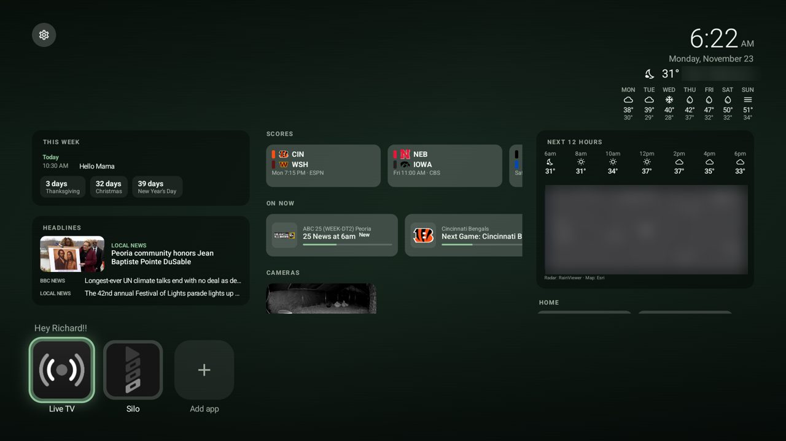

[Features](#features) · [Screenshots](#screenshots) · [Quick start](#quick-start) · [Building](#building)

</div>

## Features

<table>
<tr>
<td width="50%" valign="top">

### Vanilla Home
- Plain launcher: clock, weather, 7-day forecast, only the apps you pick
- **Widgets** in Minimal, Glance or Mirror layouts: calendar (iCal) with countdowns, news cards (any RSS), scores, hourly weather + live radar, weather alerts (NWS)
- **From Live TV:** On now, Continue watching, New on Movies & Series. OK tunes straight in
- **Home Assistant** switches, lights, locks and camera snapshots
- **Idle photo frame** from Immich or Google Photos shared albums
- Themes, accent colors, monochrome / tinted icon styles, Play Store button
- One button back to the original Google TV home

</td>
<td width="50%" valign="top">

### Live TV
- Full TV guide, favorites, recents, search, number entry, last channel
- **Game day:** your teams' live games up top, one press to the right channel, score bar over whatever you're watching, kickoff reminders
- **Multiview:** 2–4 games at once, you pick the channels
- **Movies & Series** from your providers, resume per profile
- **Profiles** with colors, PINs and a Kids mode
- **Dispatcharr** by default, plus Xtream Codes and M3U sources added right on the TV
- Empty event slots stay hidden until a game is on

</td>
</tr>
<tr>
<td valign="top">

### Setup wizard
- Runs on Windows, macOS or Linux and opens in your browser
- Walks you through wireless debugging and pairing
- Detects the device and only removes bloat known to be safe for it (reversible)
- Pushes your theme, widgets, sports and profiles to every box
- Export / import your settings

</td>
<td valign="top">

### Channel lineup (Dispatcharr)
- Merges every provider into **one** guide, with automatic backups per channel
- Respects each provider's stream limit
- Keeps your country (plus any you tick, e.g. UK sports and 4K)
- **What's left out:** browse every hidden group and add any back
- Rebuilds itself when you add or drop a provider

</td>
</tr>
</table>

## Screenshots

| Live TV home | Sports |
|---|---|
| 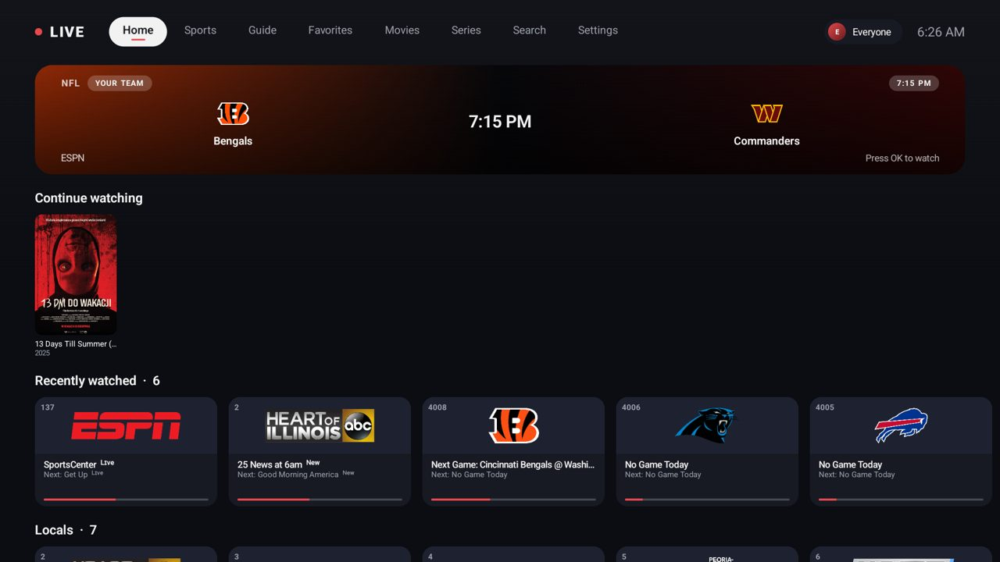 | 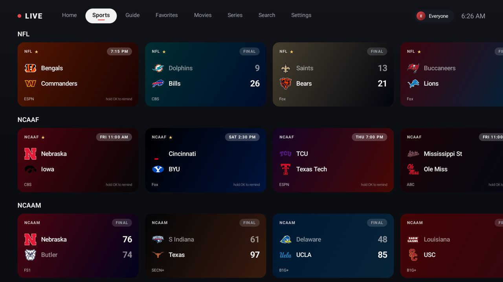 |
| **Guide** | **Settings** |
| 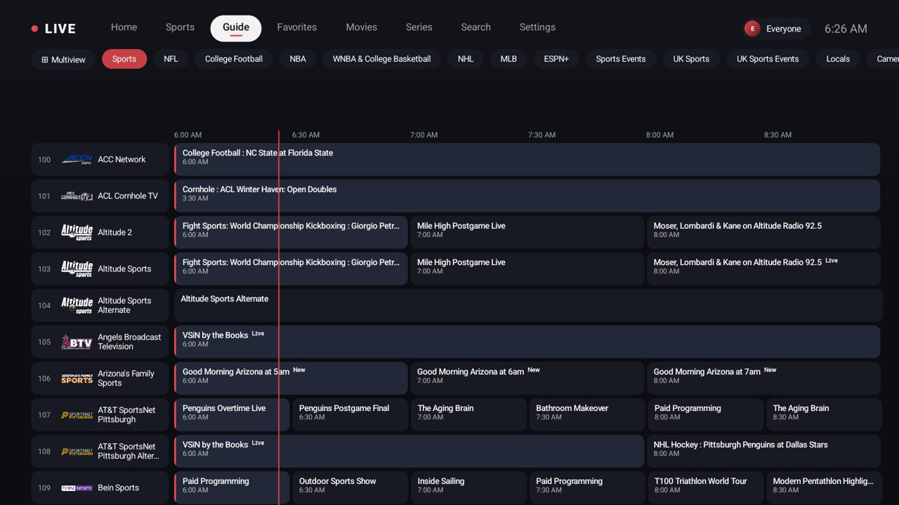 | 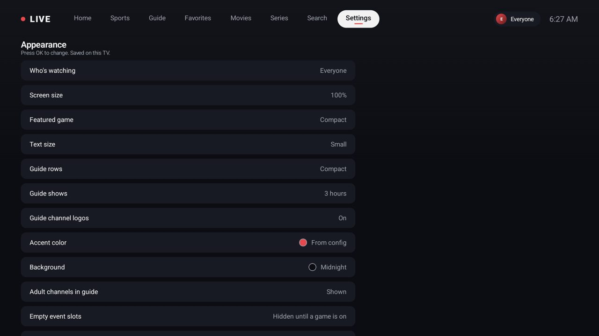 |
| **Movies** | **Series** |
| 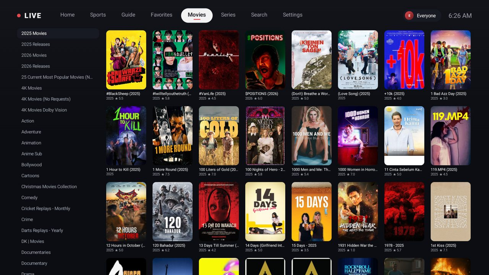 | 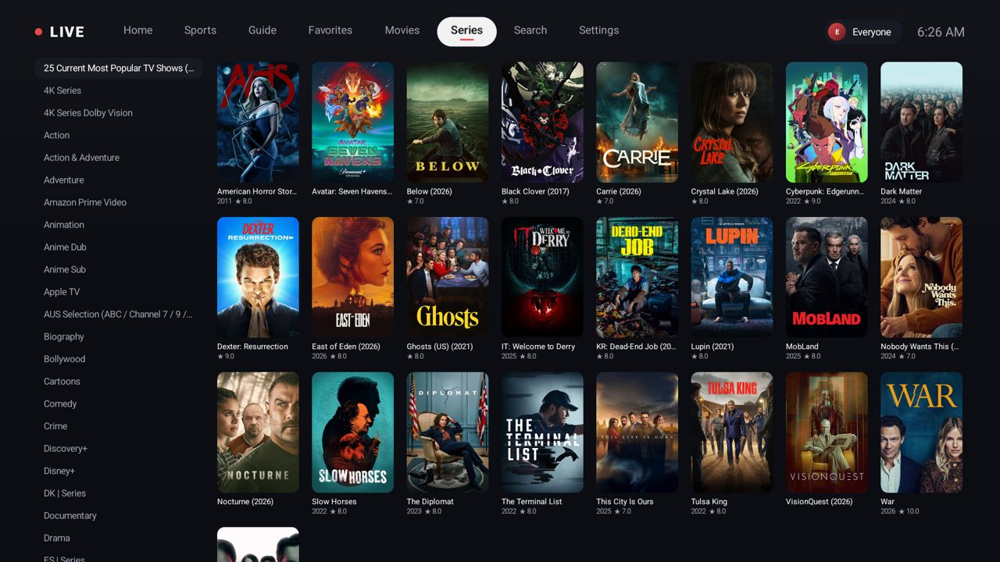 |

<details>
<summary><b>Setup wizard</b></summary>

| Live TV source | Home screen |
|---|---|
| 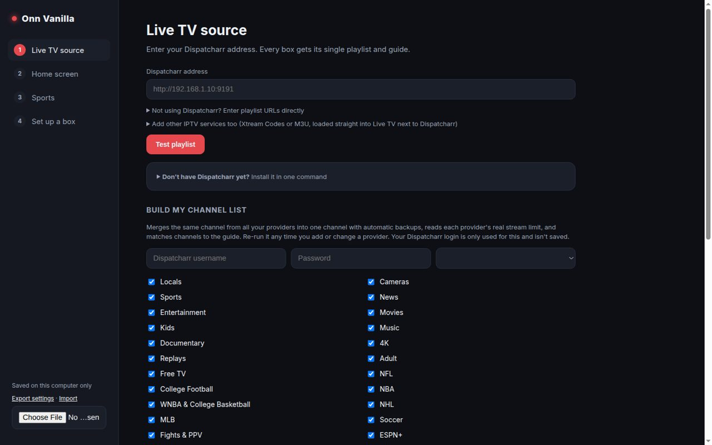 | 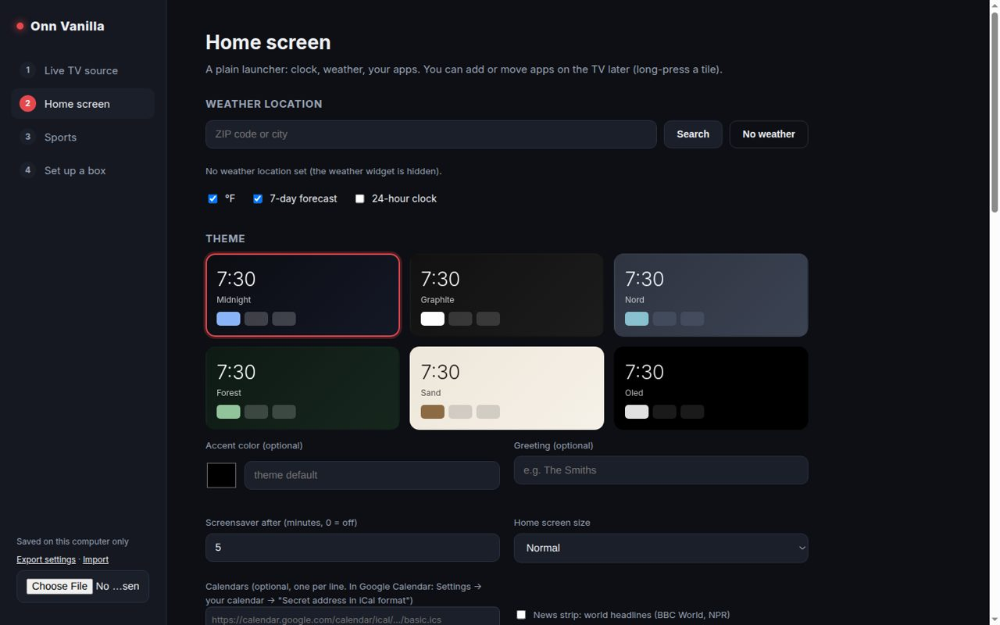 |
| **Sports** | **Set up a box** |
| 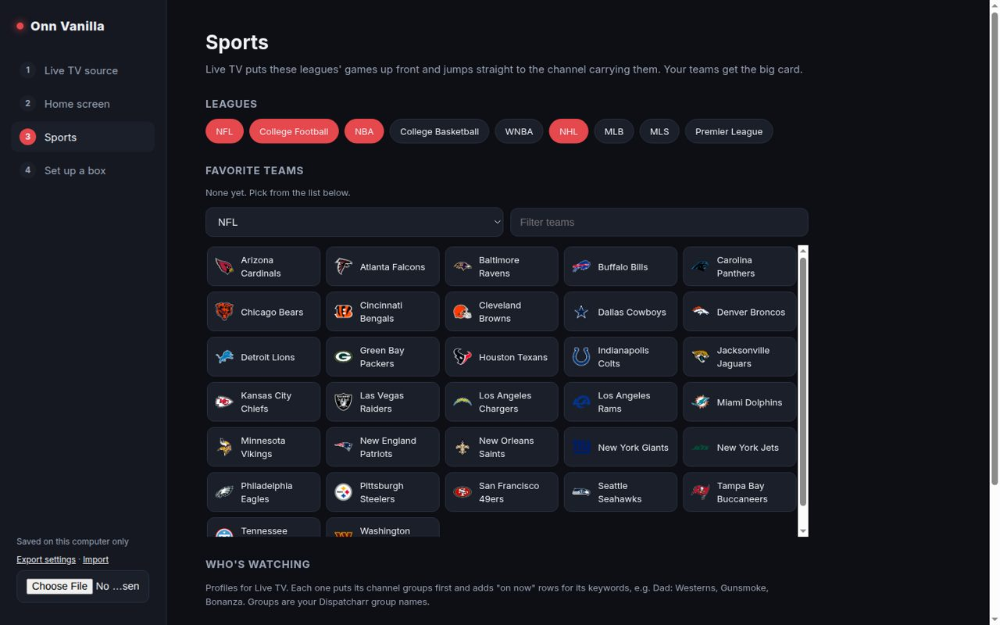 | 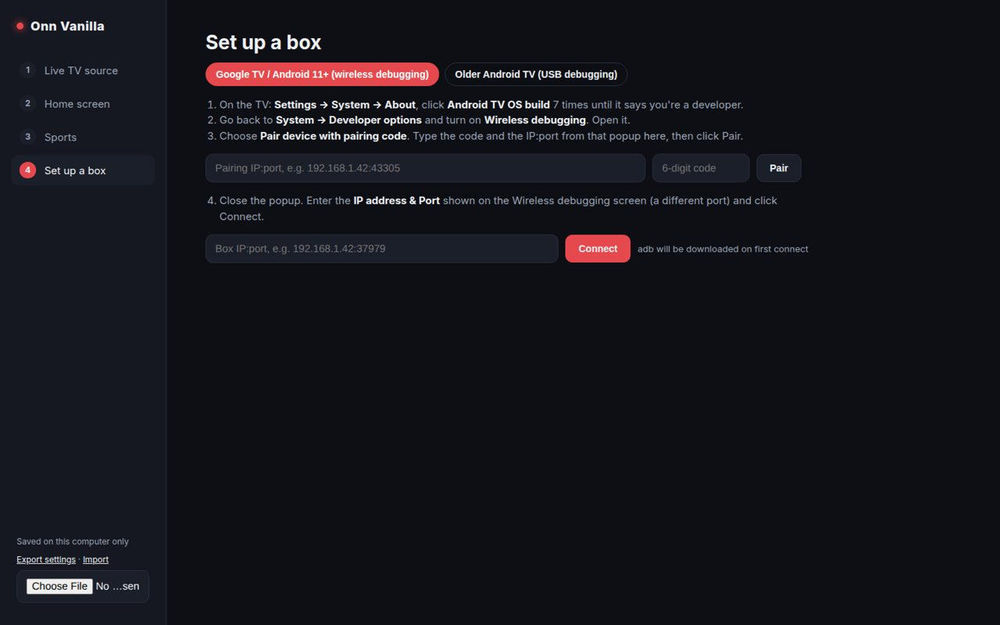 |

</details>

Nothing personal ships in this repo. The setup app keeps your settings on your computer only.

## Quick start

### 1. Server (once)

On any always-on Linux machine:

```sh
git clone https://github.com/neilyboy/onn-vanilla && cd onn-vanilla/server && ./install.sh
```

This installs Docker if needed, starts Dispatcharr on port 9191, asks for your local TV market, and schedules a nightly channel-list refresh. Re-running it on a new server rebuilds everything the same way. Then:

1. Open `http://<server>:9191` and create your admin login.
2. **M3U & EPG Manager → Add M3U → Xtream Codes**, once per provider (server URL, username, password). Wait for each to finish loading.
3. Build the channel list: install the [Lineup Manager plugin](https://github.com/neilyboy/dispatcharr-lineup-manager) (Dispatcharr → Plugins → Import), press **Build lineup**, then **Turn on schedule**. Without the plugin, `./refresh-lineup.sh` does the same from the command line.

### 2. Your channel list

Providers list the same channel many times (once per provider, plus HD/FHD/backup copies) and mix in event slots and foreign groups. The [Lineup Manager plugin](https://github.com/neilyboy/dispatcharr-lineup-manager) (or the same rules in [`server/dispatcharr/curate.py`](server/dispatcharr/curate.py) for the command line) turns that into one tidy guide:

- **Merges duplicates** of linear channels (ESPN, CNN, locals…) across providers by guide ID or name. Each merged channel keeps every copy as a backup, best provider first. If a provider is down or at its limit, Dispatcharr switches to the next.
- **Reads each provider's real stream limit** from its Xtream account and sets it in Dispatcharr.
- **Sorts everything into groups**, sports first: Locals, Sports, News, Entertainment, Movies, Kids, Music, Documentary, Free TV, NFL, College Football, NBA, NHL, MLB, Soccer, Fights & PPV, ESPN+, Sports Events, 24/7 Channels, Replays, Adult, Cameras. Foreign-language groups are left out.
- **Matches channels to the guide.**

Your choices live in `~/.config/onn-vanilla/lineup.json` (copied from [`lineup.full.example.json`](server/dispatcharr/lineup.full.example.json)). Each group is a list of regexes matched against your providers' group names. Remove a group, rename one, change its channel number, or set `"include"` to your city and call letters for Locals.

**When you add or change a provider:** add it in Dispatcharr, let it load, then run `./refresh-lineup.sh` or wait for the nightly run. New channels are merged in, dead ones are removed, and channel numbers stay put. Use `./refresh-lineup.sh --dry-run` to preview changes.

**Other countries and what's hidden:** only your country's channels are kept (`"countries": "US|USA"` in the lineup file). Add another country (the plugin's **Countries to keep**, e.g. `US|USA|UK|GB`) to get, say, the UK's sports, sports events and TV as their own groups, including their 4K sports feeds. 4K/UHD channels get their own **4K** group. Empty event slots (`NBA 12: NO EVENT`) are kept by default, because providers rename them when a game is on; set `"drop_empty_events": true` to drop them. To see everything left out, use the plugin's **What's left out** and paste any group into **Add back**, or run `./refresh-lineup.sh --hidden` on the server. Adding or dropping a provider needs nothing else: the same rules apply to the new provider's groups at the next refresh.

**Cameras and other custom streams** (RTSP/RTSPS cameras, HLS links): in Dispatcharr, add a custom stream, put it in a group named **Cameras**, and choose the **ffmpeg** stream profile. The next refresh adds it to the guide.

### 3. TV boxes

Download `onn-vanilla-setup-<your OS>` from [Releases](../../releases) and run it. Your browser opens the wizard:

1. **Live TV source:** your Dispatcharr address. Test the playlist, or build the channel list from here.
2. **Home screen:** weather location (ZIP or city), theme, accent, clock and greeting.
3. **Sports:** leagues and favorite teams.
4. **Set up a box:** the wizard walks you through turning on **Wireless debugging** (Android 11+/Google TV) and pairing with the code on screen, or USB debugging on older boxes. Click **Inspect**, tick the apps to remove, run a **Dry run**, then **Set up this box**.

The setup app downloads Google's `adb` itself if you don't have it. To run it on a headless server and open it from another computer, use `--listen 0.0.0.0`. It prints a link that contains a one-time access token.

### Live TV appearance

Each TV keeps its own look: **Live TV → Settings** has screen size, text size, guide row height, 2/3/4-hour guide, channel logos, accent color, background, adult channels, empty event slots and the score bar.

## What gets removed

Only what you tick in the wizard. The list is in [`setup/bloat.txt`](setup/bloat.txt): stock launchers, Assistant, ambient mode and preloaded streaming apps. Apps are removed with `pm uninstall --user 0`, which keeps the system copy, so **Restore removed apps** in the wizard brings every one back. Settings, Bluetooth remote pairing, HDMI-CEC, Wi-Fi, display/audio settings and codecs are never touched. The Play Store stays unless you choose otherwise, so you can still install apps (Silo, Kodi, etc.) and add them to Home with the **+** tile.

## Building

Requires JDK 17, the Android SDK, Gradle 8.9 and Go 1.22.

```bash
./scripts/build-all.sh      # APKs + setup binaries for every OS -> dist/
```

Release APKs are signed with `keystore.properties` if present, otherwise with the debug key. Pushing a `v*` tag builds everything on GitHub Actions and attaches it to a release. Add `KEYSTORE_B64`, `KEYSTORE_PASSWORD` and `KEY_ALIAS` secrets to sign with your own key.

Power users can skip the wizard: `provision/provision-onn.sh <box-ip> --dry-run` does the same from a shell (copy `provision.conf` to `provision.local.conf` first).

## Layout

| Path | What |
|---|---|
| `launcher/` | Vanilla Home (Kotlin, Compose for TV) |
| `livetv/` | Live TV (Kotlin, Compose, Media3) |
| `setup/` | Setup app (Go, single binary, embedded web wizard) |
| `provision/` | Shell provisioning + restore scripts |
| `server/` | Dispatcharr compose file and an example shared launcher config |

## License

MIT. Sports data comes from ESPN's public scoreboard API, weather from Open-Meteo, and geocoding from Open-Meteo and Zippopotam.us. This project is not affiliated with any of them, or with Onn/Walmart or Google.
